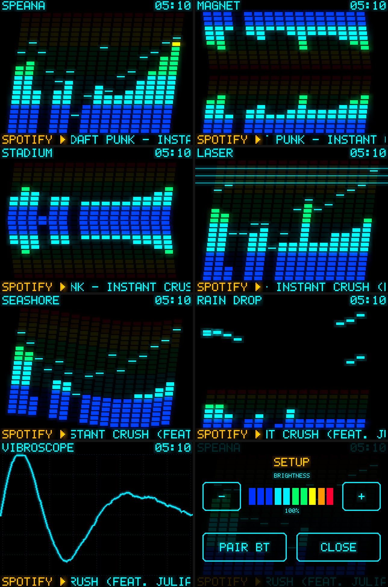

# Kenwood VFD music visualizer: Pi 3B+ and 2.8" SPI screen

A DPX-6200M style VFD spectrum analyzer (6-colour slanted segments, peak hold, and the 7 Kenwood modes: SPEANA, MAGNET, STADIUM, LASER, SEASHORE, RAIN DROP, VIBROSCOPE). It runs on a **Raspberry Pi 3B+** with the red **2.8" 320×240 ILI9341 touch module (MSP2807)**.



```
pi/
  kenwood_vis.py      the visualizer (pygame, writes straight to the SPI framebuffer)
  vfd_font.py         5x7 dot-matrix VFD font
  spotify_event.py    sends Spotify track names to the screen
  install.sh          sets up everything on the Pi
  system/             ALSA routing + systemd services used by install.sh
original/             the April 2026 browser / pygame versions this is based on
HANDOFF.md            project history
```

---

## Where does the music come from? (no mic, no room sound)

The visualizer **never uses a microphone**. It reads the exact digital audio the Pi is playing, so talking, road noise or a loud car next to you can't move the bars.

That means **the Pi has to be the thing playing the music**:

```
 phone (Spotify)                    Raspberry Pi 3B+
 ───────────────     Wi-Fi     ┌────────────────────────────┐
  Spotify Connect ───────────► │ raspotify ─┐               │      3.5 mm jack
                               │            ├─► kenwood_out ├──► speakers / amp / car AUX
  any app over    Bluetooth    │ bluealsa  ─┘       │       │
  Bluetooth     ─────────────► │                    ▼       │
                               │             ALSA loopback  │
                               │                    │       │
                               │        kenwood_vis.py ─────┼──► 2.8" screen
                               └────────────────────────────┘
```

There are two ways to send music to it. You can use either or both:

| | **Spotify Connect** | **Bluetooth** |
|---|---|---|
| How | In Spotify tap **Devices** and pick **KENWOOD-VIS** | Pair the phone with **KENWOOD-VIS** like a speaker |
| Shows track name | Yes | Yes, if the phone sends it (most do) |
| Needs | **Spotify Premium**, and the phone and Pi on the same Wi-Fi (in a car, connect the Pi to your phone's hotspot) | Nothing, and it works with any app |
| Sound quality | 320 kbps straight from Spotify | Bluetooth SBC |

It does **not** use Spotify's servers to get "beat data". Spotify shut down that API for new apps in Nov 2024, and real audio is more accurate anyway.

> If your phone plays straight to the car's own Bluetooth, the Pi can't hear anything. The sound has to go **through** the Pi, which then sends it on to your speakers through the headphone jack (or a USB sound card).

---

## Parts

- Raspberry Pi 3B+ with a good 5 V 2.5 A supply (in a car, use a proper 12 V→5 V 3 A converter, because a weak one causes freezes)
- A microSD card for the Pi (8 GB+). **The red screen board does not need an SD card.** Its SD slot is an optional extra and can stay empty.
- The red 2.8" MSP2807 module
- 13 female-to-female jumper wires
- A 3.5 mm cable to your speaker/amp/AUX (or a USB DAC)

---

## Wiring

Leave the **J1** pads on the red board **open** (not soldered), so its regulator takes 5 V. All the signal pins are 3.3 V, the same as the Pi, so no level shifter is needed.

| Screen pin | Pi physical pin | Pi GPIO | Notes |
|---|---|---|---|
| VCC | **2** | 5V | |
| GND | **6** | GND | |
| CS | **24** | GPIO 8 (CE0) | display select |
| RESET | **22** | GPIO 25 | |
| DC | **18** | GPIO 24 | |
| SDI (MOSI) | **19** | GPIO 10 (MOSI) | |
| SCK | **23** | GPIO 11 (SCLK) | |
| LED | **16** | GPIO 23 | backlight dimming. Or use pin **17** (3.3 V) for always-on |
| SDO (MISO) | *not connected* | | leave it off, since it can jam the touch data |
| T_CLK | **23** | GPIO 11 | shares the pin with SCK |
| T_CS | **26** | GPIO 7 (CE1) | touch select |
| T_DIN | **19** | GPIO 10 | shares the pin with SDI |
| T_DO | **21** | GPIO 9 (MISO) | |
| T_IRQ | **11** | GPIO 17 | |

Pins 19 and 23 each take two wires. Use a Y-splice, or solder two wires into one female header.

```
         Pi 3B+ GPIO header (pin 1 = the end farthest from the USB ports)
                  3V3  (1) (2)  5V ◄─── VCC
                       (3) (4)
                       (5) (6)  GND ◄── GND
                       (7) (8)
                       (9) (10)
  T_IRQ ──► GPIO17 (11) (12)
                      (13) (14)
                      (15) (16) GPIO23 ◄── LED
            3V3       (17) (18) GPIO24 ◄── DC
  SDI+T_DIN ► MOSI    (19) (20)
  T_DO ────► MISO     (21) (22) GPIO25 ◄── RESET
  SCK+T_CLK ► SCLK    (23) (24) CE0 ◄───── CS
                      (25) (26) CE1 ◄───── T_CS
```

These pins leave the Pi's headphone jack working. The installer avoids GPIO 18 for the backlight on purpose, because using it for PWM would break the analog audio.

---

## Install

1. **Flash the SD card.** In Raspberry Pi Imager choose **Raspberry Pi OS Lite (64-bit)**. Under the ⚙ settings, set a username and password, your Wi-Fi, and turn on SSH. (Use Lite, not Desktop, because the Desktop's PipeWire takes over Bluetooth audio.)
2. Boot the Pi, then SSH in: `ssh <user>@<pi-name>.local`
3. Get the code and run the installer:
   ```bash
   sudo apt-get install -y git
   ```
   ```bash
   git clone -b claude/elegant-rubin-p9psvt https://github.com/cooldude-7/visualizer.git
   ```
   ```bash
   cd visualizer/pi && ./install.sh
   ```
   (If the repo is private, download the ZIP from GitHub and copy it over with `scp` instead.)
4. `sudo reboot`. The screen lights up with **READY** and the mode name.
5. **Spotify:** open Spotify > Devices > **KENWOOD-VIS**.
   **Bluetooth:** hold a finger on the screen for 1 s > **PAIR BT** > pick KENWOOD-VIS on the phone (the pairing window is open for 3 minutes).

### Installer options

| Example | Effect |
|---|---|
| `NO_SPOTIFY=1 ./install.sh` | Bluetooth only (no Premium needed) |
| `OUTPUT_CARD=Device ./install.sh` | Sound to a USB DAC (get the name from `aplay -l`) |
| `ROTATE=270 ./install.sh` | Screen upside down? Flip it |
| `SPI_MHZ=48 ./install.sh` | Faster screen updates (go back to 32 if you see glitches) |
| `DEVICE_NAME=MYCAR ./install.sh` | Change the Bluetooth/Spotify name |

Run it again any time. It replaces its own settings instead of adding duplicates.

---

## Using it

- **Tap**: next mode (it remembers the mode after a reboot)
- **Hold 1 s**: setup screen, with brightness − / +, **PAIR BT** and CLOSE
- **Top row**: mode name, a `BT` indicator, clock
- **Bottom row**: source (SPOTIFY / BT / READY) and a scrolling artist and title
- After 10 minutes of silence the screen dims to 15% (change `idle_dim_minutes` in the config)

> The clock is only right when the Pi has internet (Wi-Fi or a hotspot), because the Pi 3B+ has no clock battery. You can hide it with `"show_clock": false`.

### Touch calibration (once)

If the setup buttons don't respond where you press:
```bash
sudo systemctl stop kenwood-vis
```
```bash
sudo python3 /opt/kenwood-vis/kenwood_vis.py --calibrate
```
```bash
sudo systemctl start kenwood-vis
```
Tap the three crosses. Mode switching works without calibrating, since any tap counts.

### Settings: `/etc/kenwood-vis.json`

Only put in the keys you want to change. The defaults are at the top of `kenwood_vis.py`.
```json
{
  "bands": 16,
  "treble_tilt_db_per_octave": 3.0,
  "range_db": 42,
  "fps": 30,
  "swap_red_blue": false,
  "rotate_180": false,
  "backlight_gpio": 23,
  "clock_24h": true,
  "idle_dim_minutes": 10
}
```
- High bands too quiet: raise `treble_tilt_db_per_octave`. Bars always maxed out: raise `range_db`.
- LED wired to 3.3 V instead of GPIO 23: set `"backlight_gpio": null` (brightness is then done by dimming the picture).

Then run `sudo systemctl restart kenwood-vis`.

---

## Testing without the hardware

On any computer with Python:
```bash
pip install pygame numpy
```
```bash
python3 pi/kenwood_vis.py --window --demo
```
This opens a 2× preview window with fake music. Click to change mode, and hold the mouse button for setup.

---

## Troubleshooting

| Problem | Check |
|---|---|
| **White screen** | The overlay didn't load, or the DC/RESET/CS wiring is wrong. Run `dmesg \| grep -iE 'fbtft\|ili9341'` and `cat /sys/class/graphics/fb*/name` (one should say `fb_ili9341`) |
| **Black screen, backlight on** | `journalctl -u kenwood-vis -e` for errors |
| **Red and blue swapped** | Remove `bgr,` from the `dtoverlay=fbtft` line in `/boot/firmware/config.txt`, or set `"swap_red_blue": true` |
| **Upside down / mirrored** | Re-run with `ROTATE=270`, or set `"rotate_180": true` |
| **Touch does nothing** | `dmesg \| grep ads7846`. Check T_IRQ is on pin 11 and T_CS on pin 26 |
| **No sound** | `speaker-test -D kenwood_out -c 2 -t sine -l 1`. If silent, check `aplay -l` and `OUTPUT_CARD` |
| **Sound OK but bars don't move** | While music plays: `arecord -D plughw:Loopback,1,0 -f S16_LE -r 44100 -c 2 -d 3 /tmp/t.wav && aplay /tmp/t.wav`. Make sure the snd-aloop module is loaded: `lsmod \| grep aloop` |
| **KENWOOD-VIS not in Spotify** | You need Premium, and the phone and Pi must be on the same network. Run `systemctl status raspotify` |
| **Phone can't find it on Bluetooth** | Hold the screen > PAIR BT first. Run `systemctl status kenwood-bluealsa kenwood-bt-agent` |
| **Glitchy picture** | Lower the speed: re-run with `SPI_MHZ=24`, and keep the jumper wires short (under 15 cm) |

Logs: `journalctl -u kenwood-vis -f`

### In a car

Pulling the power while the Pi is writing to the SD card can corrupt it. Once everything works, you can turn on **raspi-config > Performance > Overlay File System** to make the card read-only. The catch is that new Bluetooth pairings and the remembered mode and brightness will be forgotten on every reboot.
